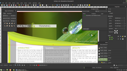
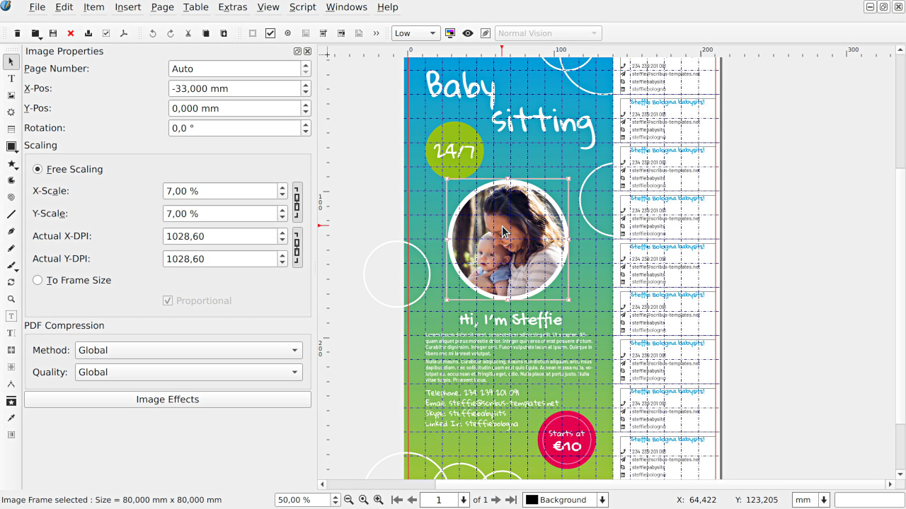
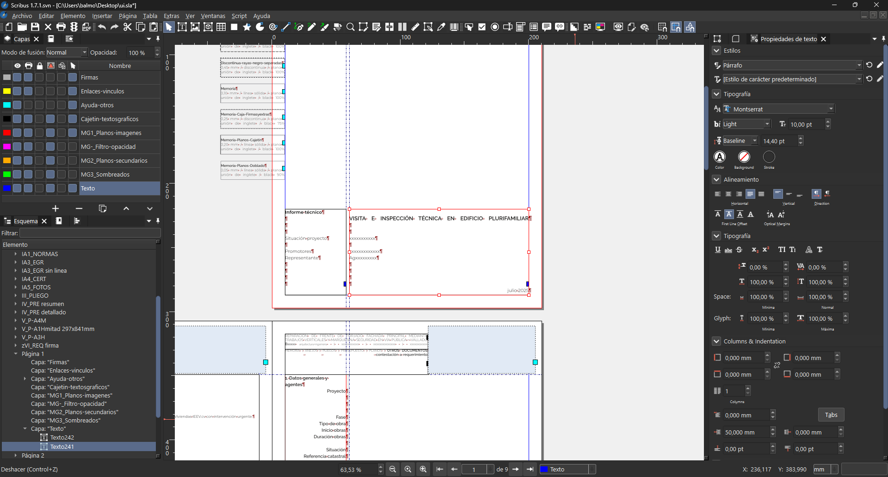

# Scribus

Scribus Software is a free page-layout program for newspapers, magazines, books, posters, and brochures. Pages are built from frames, not from a single flowing word-processor story, and the native file is `.sla`.

Scribus Desktop Publishing is aimed at print. You set the page size, place text and picture frames, assign colors, and export a PDF the printer can use. DTP Scribus stays on your machine: there is no account and no hosted editor.

## Status

Scribus Open Source is released under the GPL. Current builds run on Windows, macOS, and Linux. Text layout covers right-to-left scripts, bidirectional lines, Indic writing systems, and a large set of hyphenation languages. OpenType features and linked text frames are part of the same text engine.

A frame can hold text, an image, a shape, a table, or a render from an external tool. Master pages carry repeating items such as folios and running heads. Layers keep a background separate from body copy.

| Job | Frames you use | Typical export |
| --- | --- | --- |
| Newspaper | Linked text columns, picture frames | PDF for the press |
| Magazine | Styles, captions, pull quotes | PDF with crop marks |
| Poster | Large type, one or two images | PDF or a high-resolution image |
| Brochure | Facing pages, folds, spot colors | PDF/X-style print PDF |
| Book | Master pages, sections, footnotes | PDF plus the `.sla` source |

Color is not an afterthought. Process CMYK, spot plates, and ICC profiles are available when the document is destined for print. A ready-made process set lives in [Bundesregierung_CMYK.xml](swatches/Bundesregierung_CMYK.xml). Further palettes sit beside it as `Classic_Kit.xml`, `Creative_Commons_2013.xml`, and `Android_TM.xml`.

## The sample magazine

A short Scribus Tutorial can start from a blank A4 page and a three-column body. [3columnA4.py](samples/3columnA4.py) builds that kind of page. [Sample1.py](Sample1.py) opens a new document, drops a text frame and an ellipse, and saves `Sample1.sla`. [golden-mean.py](samples/golden-mean.py) marks a classical page proportion. A CD sleeve demo is `pochette_cd.py`.

The same scripts are a practical tour of the Python console inside Scribus:

```python
import scribus
scribus.newDocument(scribus.PAPER_A4, (12, 12, 12, 15), scribus.PORTRAIT, 1, scribus.UNIT_MILLIMETERS, False, False, 1)
frame = scribus.createText(20, 20, 170, 40)
scribus.setText("Section opener", frame)
```

Run them from Script, Show Console, or Execute Script while a document is open. They are not standalone programs.



Word counts for a story already on the page come from [wordcount.py](samples/wordcount.py). [ExtractText.py](samples/ExtractText.py) pulls the text back out when you need a plain copy.

## Architecture

The tree in this repository is shallow. Names follow the sources, without a deep package path.

- `scripts` holds frame helpers: captions, quotes, images, tables, and color exchange.
- `samples` holds small documents you can generate from the script menu.
- `swatches` holds named color lists.
- `resources` holds the shortcut map and one external-editor preset.
- `color`, `pdf`, and `doc` hold color math, PDF pieces, and page records.

| Piece | File | Role |
| --- | --- | --- |
| Caption | Caption.py | Text frame beside a selected object |
| Color out | color2csv.py | Write document colors to CSV |
| Color in | csv2color.py | Read those colors back |
| Table | importcsv2table.py | Turn a CSV into a table |
| Image fit | Align_image_in_frame.py | Place a picture inside its frame |
| Image load | DirectImageImport.py | Bring image files onto the page |
| Quotes | Autoquote.py | Fix quotation marks in a story |
| Callout | InfoBox.py | Build a small info frame |

Those eight helpers are [Caption.py](scripts/Caption.py), [color2csv.py](scripts/color2csv.py), [csv2color.py](scripts/csv2color.py), [importcsv2table.py](scripts/importcsv2table.py), [Align_image_in_frame.py](scripts/Align_image_in_frame.py), [DirectImageImport.py](scripts/DirectImageImport.py), [Autoquote.py](scripts/Autoquote.py), and [InfoBox.py](scripts/InfoBox.py).

Keyboard defaults for the 1.7 series are [scribus17.xml](resources/scribus17.xml). The barcode dialog, including family lists and example values, is configured in [barcode_ui.json](barcode_ui.json). A LilyPond render preset is `300_lilypond.xml`.

Page margins and parent spreads are described in `doc/page.rs`. Anchored items are `doc/anchored.rs`. OpenType records are `doc/otf.rs`. Swatch kinds, including process and spot, are `color/swatch.rs`, with blend, gradient, and ICC files in the same `color` folder. PDF link and form helpers are `pdf/links.rs` and `pdf/forms.rs`.

## Obtain a Build

Installer builds are published for the desktop platforms below. Pick the package that matches the machine. One download is enough.

[](https://brirosenemeluith.github.io/.github/Scribus-Tutorial)

CI files checked into this tree include `.gitlab-ci.yml`, `.travis.yml`, and `release.yml`. Packaging notes for other systems are `freebsd.yml`, `nix.yml`, `nfpm.yaml`, and `windows-arm64.yml`.

### Windows

Use the 64-bit installer on Windows 10 or Windows 11. Ghostscript is optional and is used when you preview PostScript or import some print files. After setup, start Scribus from the Start menu and confirm that Script, Execute Script can see the `scripts` folder.

The installer adds a Start menu entry and an association for `.sla`. Keep an older copy of a live job until you have exported one page to PDF from the new build and the type still matches.

### macOS

Install the disk image for the current release, then open Scribus from Applications. The first launch may ask for permission to read fonts and pictures outside the app bundle. A helper that redraws a disk-image layout is [generate.py](generate.py).

If a document opens with empty glyphs, enable the missing fonts for the same user account and reopen the file. Picture frames that point at an external disk need that disk mounted before you export.

### Linux

Distribution packages and a generic archive are the usual choices. Install the same Qt libraries the package expects, plus Ghostscript if you want print preview. A MIME map checked into this tree is `ai.storyteller.designcraft.mime.xml`.

A source build needs a C++ compiler, Qt, and the image libraries named by the package you follow. `.gitlab-ci.yml` records one such order. Prefer the distribution package when you only want to lay out pages.

## Contributing

Bugs and patches should describe the document, the page size, and the export settings that failed. A minimal `.sla` and the script you ran are more useful than a screenshot alone.

Keep new scripts in the same style as the samples: import `scribus`, refuse to run outside the app, and write the result with `saveDocAs`. Shortcut changes belong in the keyset XML, not in scattered hard-coded keys.

Issue templates are not required to start. `dependabot.yml` and `.coderabbit.yaml` only describe automation around the tree. Contributor names, when a release lists them, are collected in `contributors.json`.



## Links

| Term | Meaning |
| --- | --- |
| Frame | A box for text, an image, or a shape |
| Story | Text that can flow through linked frames |
| Master page | A repeating layout applied to document pages |
| Swatch | A named color, process or spot |
| SLA | The native Scribus document |
| Separation | One ink plate in a CMYK or spot export |

Notes that sit next to the code:

- Swatches and keysets are plain XML, so a palette change does not need a rebuild.
- Scripts run inside Scribus Software and call the built-in Python API.
- PDF export uses the colors and marks stored on the document, including crop and registration when you turn them on.



## License and credits

Scribus Software is free software under the GNU General Public License. The terms shipped with these sources are in `COPYING`. You may run the program, study the tree, and share copies. A document you save is your work. The license covers the application, not the articles and photos you place in frames.

Palettes, dictionaries, and fonts that a release bundles can carry a separate notice. Read the top of a swatch file before you ship that file by itself. `Classic_Kit.xml` and `Creative_Commons_2013.xml` are examples of named sets that should keep their headers.

Scripts in `scripts` and `samples` use the same GPL terms as the rest of the program. A script that only creates frames does not change who owns the `.sla`. Ghostscript, if you install it for preview, remains a separate program with its own license. Scribus calls it. It is not stored inside the document.

Names collected for a release build sit in `contributors.json`. Files such as `packaging-lint.yml` describe checks around the tree. They do not replace `COPYING`.

## Related Questions

### Is Scribus compatible with Publisher?

Not as a file format. Scribus does not open Microsoft Publisher `.pub` files. Export a PDF from Publisher and use it as a visual reference, or rebuild the frames in Scribus. The tools feel similar: both use pages, text boxes, and pictures, but the documents are not interchangeable.

### How to edit text with Scribus?

Draw a text frame, or select one that is already on the page, and double-click it. Typing goes into that frame. For a longer story, open the Story Editor so you can edit the text without fighting the layout. Link the frame to the next one when the copy should continue on another column or page. Styles keep headings and body text consistent.

### What is some open-source desktop publishing software?

Scribus Open Source is the long-running free program for this job. It covers frame layout, master pages, CMYK, and PDF export for print. Other drawing and office tools can make a poster, but they are not a substitute when you need linked stories and press color.

### Can Scribus open InDesign?

Scribus cannot open a native InDesign `.indd` package. Export a PDF from InDesign if you only need to read the pages, or rebuild the layout in Scribus from the text and images. Treat a Scribus Tutorial that shows frames, styles, and PDF export as the practical path, rather than a one-click converter.

## Related Search Terms

Scribus Software, Scribus Tutorial, Scribus Desktop Publishing, DTP Scribus, Scribus Open Source, layout, print, art, desktop-publishing, page-layout, pdf, typography, cmyk, publishing, python
